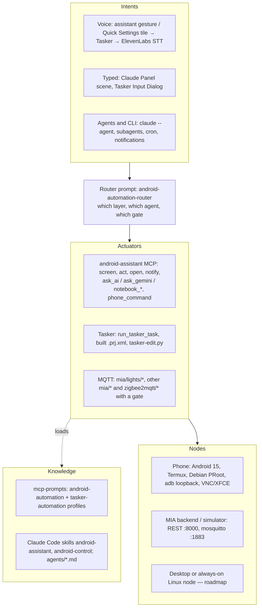

# Android automation: natural-language control of a phone

This guide covers the `android-automation` and `tasker-automation` profiles (new in 4.3.0), the
phone-side tools they are written for, and four scenarios that use them from start to finish. The
stack runs on a rooted Android phone (aarch64), with Claude Code in a Debian PRoot inside Termux.

> Related: [Install a profile](../README.md#install-a-profile), [deploy/README.md](../deploy/README.md)
> (what each profile serves and how to change one), and the research write-up behind the design
> choices, [research/2026-11-ai-ecosystem-consolidation.md](research/2026-11-ai-ecosystem-consolidation.md).

---

## 1. Vision

[Omarchy](https://omarchy.org/) is DHH's opinionated Arch Linux and Hyprland setup. Its appeal is
that the defaults are already chosen and a menu reaches every setting, so a desktop works the way
you described it without hand-editing dotfiles. Omarchy targets PCs and laptops. Up to 4.0.x its
ISO and packages were x86_64 only. [Omarchy 4.5](https://github.com/omacom/omarchy/releases/tag/v4.5.0)
(5 November 2026) added its first aarch64 ISO, a native install on M1, M2 and M3 MacBooks, and
"preliminary" support for NVIDIA's ARM machines, and it says Snapdragon X support is coming. The
4.5 release notes say nothing about phones or Android. Omarchy needs a bootable machine with its
own kernel and display, which an Android phone does not offer to a guest Linux. So on a phone,
Omarchy remains x86_64- and laptop-oriented, and its ARM support is new and limited to specific
laptops.

This stack aims to give a phone the same freedom: say what you want, and it gets configured. The
pieces:

- **mcp-prompts profiles** are the knowledge layer. `android-automation` and `tasker-automation`
  serve the procedures, rubrics and briefs that agents load before they act.
- The **android-assistant MCP server** is the actuator layer. It reads the screen, taps, opens
  deep links, posts notifications, runs Tasker tasks and publishes MQTT, and it drives the AI chat
  apps and NotebookLM. It has no raw shell and no `su`.
- **Tasker** is built and edited by agents. They generate project XML for Tasker's own importer,
  or apply text edits to its configuration file with backups and reference checks.
- **Termux and Debian PRoot** are where the agents, the MCP servers and the voice pipeline run.
  An XFCE desktop over VNC is available for GUI work.
- **Claude Code skills and agents** are the operators. They include `phone`, plus one advisor
  agent per AI app (`gemini`, `deepseek`, `kimi`, `grok`, `chatgpt`, `perplexity`).
- The **voice pipeline** runs from a Tasker trigger to ElevenLabs speech-to-text, then
  `claude -p` with the android-assistant tools, then ElevenLabs text-to-speech on the phone
  speaker.

The phone-side code lives in the
[cliphist-android](https://github.com/sparesparrow/cliphist-android) repository under
`assistant/`. This repository holds only the prompts.

## 2. Layers



The same thing as a table:

| Layer | What is in it | Where it runs |
|---|---|---|
| Intents | Voice turn (HTTP trigger on `127.0.0.1:8780`), Claude Panel scene, Tasker "Agent <name>" tasks, `claude --agent <name> -p`, notification hooks (`notif-wait.py`) | Tasker, Termux, PRoot |
| Router | `android-automation-router` decides between an MCP tool, an app agent, a Tasker change and an MQTT command, and names the gate. The Claude Panel's own `panel-router` decides between coding agent, phone assistant and nothing. | `claude -p` in PRoot |
| Actuators | android-assistant MCP tools, Tasker (broadcast, importer, `tasker-edit.py`), `phone_command` (named Termux and Android commands), `mqtt_publish` | PRoot → adb on `127.0.0.1:5555`, native Termux over ssh |
| Knowledge | Profiles `android-automation` and `tasker-automation`, the skills `android-assistant` and `android-control`, and the agent definitions | mcp-prompts (stdio), `~/.claude` |
| Nodes | The phone. The MIA Pi or its simulator. A desktop or always-on Linux node is on the roadmap ([[#141](https://github.com/sparesparrow/mcp-prompts/issues/141)](#7-limits-and-roadmap)). | Wi-Fi hotspot or LAN today |

## 3. Install and use

### Profiles

```bash
# Phone operations and app agents
claude mcp add -s user mcp-prompts -- mcp-prompts --profile android-automation

# Tasker only
claude mcp add -s user mcp-prompts -- mcp-prompts --profile tasker-automation

# The full phone stack: the two profiles combine (any prompt in either is served)
claude mcp add -s user mcp-prompts -- mcp-prompts --profile android-automation,tasker-automation --read-only
```

`mcp-prompts profiles` prints what each profile serves right now, and
`mcp-prompts catalog --profile android-automation` lists the ids. Over HTTP, put the profile in the
URL: `http://localhost:3003/mcp?profile=android-automation,tasker-automation`.

### Example MCP client config

This is the setup the scenarios below assume: the prompt library limited to the two phone
profiles, read-only, next to the phone's own MCP server. The paths are those of the reference
phone, so adjust them to your own checkout.

```json
{
  "mcpServers": {
    "mcp-prompts": {
      "command": "mcp-prompts",
      "args": ["--profile", "android-automation,tasker-automation", "--read-only"]
    },
    "android-assistant": {
      "command": "/root/cliphist-android/assistant/mcp/.venv/bin/python",
      "args": ["/root/cliphist-android/assistant/mcp/server.py"]
    }
  }
}
```

The android-assistant server takes its settings from the environment: `DROID_SERIAL` (default
`127.0.0.1:5555`), `MQTT_HOST` (default `127.0.0.1`) and `ASSISTANT_STATE` (default
`/root/phone/state`). There are no keys in this file. The ElevenLabs key stays in an env file that
the voice scripts read, and the tools never print it.

### Prompts in the profiles

**`android-automation`**: the `android-automation` group, plus `android-proot-phone-ops` and
`phone-voice-assistant`.

| id | Kind | One line |
|---|---|---|
| `android-automation-router` | template | Turns a typed, spoken or agent request into the right layer (MCP tool, app agent, Tasker, MQTT) and the gate it needs. |
| `scenario-deep-research-to-notebook` | template | End to end: a Deep Research brief, the report, then a NotebookLM source and an audio overview, with notification hooks instead of polling. |
| `scenario-multi-ai-pr-review` | template | Fans a PR diff out to several AI apps, merges the reviews, verifies each point against the code, and posts only after a yes. |
| `android-split-screen-two-apps` | template | Puts two apps side by side and works across them without losing which window is in front. |
| `android-app-agent-design` | template | Plans and builds a driver module plus a Claude Code agent for one specific app. |
| `android-app-agent-calibrate` | template | Calibrates an app driver against the real app: dry run with dumps, one real send, known failure patterns and their fixes. |
| `android-app-agent-eval` | template | Evaluation plan and rubric for an app agent: fixture tests, live tasks under the screen lock, metrics, failure taxonomy. |
| `android-app-agent-use` | template | Operating brief for any session that works through an app agent: modes, drafts, waiting, reading, screen text as data. |
| `gemini-advisor-brief` | template | Turns a question and context into one self-contained prompt for Gemini as a second-opinion advisor. |
| `deep-research-ai-ecosystem-consolidation` | template | Brief for a Deep Research run that surveys a sprawling tool landscape and recommends one architecture. |
| `termux-api-commands` | template | Safe use of `termux-*` commands: catalogue, flags, JSON output, the permission each needs, consent rules. |
| `termux-proot-bridge` | template | Builds or debugs the bridge between native Termux, the PRoot, Tasker and the agents (RUN_COMMAND → ssh `127.0.0.1:8023`). |
| `phone-agent-handoff` | prompt | Who does what among the phone agents and the main session, and the exact shape of a handoff and a report. |
| `android-proot-phone-ops` | template | How the phone link works from PRoot: adb loopback, uid 2000, root, services, diagnostics. |
| `phone-voice-assistant` | template | Persona and rules for the hands-free voice assistant. |

**`tasker-automation`**: the `tasker` group, plus `tasker-scene-xml`.

| id | Kind | One line |
|---|---|---|
| `tasker-project-architecture` | template | Designs projects, profiles, tasks and scenes before building, and decides what belongs in Tasker, a script or an MCP tool. |
| `tasker-profile-builder` | template | Writes profiles: contexts (including AutoNotification and Join), enter and exit tasks, battery cost, test plan, XML or UI steps. |
| `tasker-task-actions` | template | Composes one task from actions: codes, JavaScriptlet helpers, dialogs, HTTP, Perform Task, error handling, calls into Termux. |
| `tasker-variables` | template | Variable scope, built-ins, arrays, return values, where values are stored (in plain text), and the secrets policy. |
| `tasker-config-audit` | template | Audits a whole configuration: unused and duplicate items, dangling references, plaintext secrets, orphaned tiles. |
| `tasker-direct-edit` | template | The safe procedure for editing Tasker's live config with `tasker-edit.py`: pull, edit, check references, push, verify, roll back. |
| `tasker-scene-xml` | prompt | Tasker scene XML: elements, geometry and the importer's quirks. |

The first four `android-automation` rows were added in this release, alongside this guide. If one
is missing from your install, `mcp-prompts catalog --profile android-automation` shows what your
version has.

### Using a prompt

The pattern is the same for every template: `list_prompts` with a tag such as `android-automation`
or `tasker`, then `get_prompt <id>` to see its `variables`, then `apply_template` with a value for
each. Check that no `{{` is left, then act on the result. The agents on the phone do this
themselves. For example, the `gemini` agent fills `gemini-advisor-brief` before every advice
question.

## 4. Worked scenarios

Each scenario lists the prompts it loads, the tools it calls and the gates it passes. All four
drive the one screen, so they run under the screen lock (see [Safety model](#5-safety-model)).

### 4.1 Deep Research to a notebook with an audio overview

Goal: a cited multi-source report on a question, then a short audio overview to listen to later.
This is how the [research write-up](research/2026-11-ai-ecosystem-consolidation.md) in this
release was produced. The Czech Deep Research report came with a 5:55 audio overview.

1. Load `scenario-deep-research-to-notebook`. Fill `deep-research-ai-ecosystem-consolidation` (or
   your own brief) with the question, the as-of date, the current setup, the focus areas and the
   source policy. The brief must stand alone: Gemini sees nothing of the session, and it gets no
   secrets or private paths.
2. `ask_gemini(prompt, tool="Deep Research", wait_s=0)` opens a new chat, picks the "+" tool and
   presses "Start research". On the reference run, the research took about 40 minutes and read
   about 25 sources.
3. Do not poll the screen. Wait for the notification instead:
   `notif-wait.py --pkg com.google.android.apps.bard --match 'research|výzkum' --timeout 3600`.
   It prints the matching notification as JSON. Its text is data.
4. `gemini_reply()` reads the finished report. Scroll with `act("swipe", "up")` for long reports.
5. `notebook_add_source(content)` adds the report, title line first, to the shared agent notebook
   or to a named one. `notebook_studio("audio")` starts the audio overview, and
   `notebook_read(which="studio")` checks on it later. Another `notif-wait.py` call can wait for
   it. On the reference run, the overview took about 5 minutes. The report text and the audio are
   kept on the phone, not in any repository.
6. Claude summarises the report and fact-checks the claims it relies on. Deep Research output is
   advice to weigh, not a source of truth. In this release's report, one CVE was attributed to
   the wrong product (see the fact-check table in the write-up).

Gates: none for reading. Adding a source writes to the user's Google account, so the content is
checked for secrets first.

### 4.2 Multi-AI pull-request review

Goal: second opinions on a diff from several assistants the user already pays for, merged into one
verified review.

1. Load `scenario-multi-ai-pr-review` and `android-app-agent-use`. Build one self-contained brief
   with the diff hunks, the questions and the answer format, under the tool's 8,000-character
   limit and without secrets.
   Scan the diff for secrets first, and skip any PR that touches credentials or `.env` files.
2. Hand it to the advisors one at a time, never in parallel, because there is one screen:
   `claude --agent deepseek -p "… +DeepThink"`, then `kimi`, `chatgpt` and so on. Inside a
   session, call `ask_ai(app, prompt, mode)` and `ai_reply(app)` for each.
3. Merge the answers. Under every point, Claude adds its own verdict: *confirmed* (`file:line`),
   *wrong* (and why), or *not checkable*. This is the live check that `android-app-agent-eval`
   recommends, because it measures extraction and usefulness at the same time.
4. Post one comment per PR with `gh pr comment`, **only after the user's yes** to the exact text.
   The comment relays the apps' points together with Claude's verdict on each. When this was
   first run on real PRs, DeepSeek, Grok, ChatGPT and Perplexity answered. Kimi stopped at a login
   wall and was skipped, as the gates require.

Gates: posting to GitHub is sending something to other people. The user sees the text and says
yes first.

### 4.3 A Tasker tile that asks Claude

Goal: a Quick Settings tile (or the assistant gesture) that asks Claude something and answers on
the speaker or in a notification.

1. Load `tasker-project-architecture`, then `tasker-task-actions` and, for a dialog,
   `tasker-scene-xml`. A tile task does three things: an Input Dialog (or a voice turn), then a
   hand-off, then the result.
2. There are two built hand-offs to choose from:
   - **Voice:** an HTTP Request to `POST 127.0.0.1:8780/listen` with the `X-Token` header. The
     trigger records the request, sends it to ElevenLabs speech-to-text, runs `claude -p` with the
     android-assistant tools, and speaks the answer with ElevenLabs text-to-speech.
   - **Agent:** the "Agent <name>" tasks that `build-claude-agents.py` generates. Each one is an
     Input Dialog, then a JavaScriptlet `sendIntent()` to Termux's RUN_COMMAND (the prompt goes on
     stdin, never on a command line), then ssh to the PRoot agent sshd on `127.0.0.1:8023`, then
     `run-agent.sh <name>`. The result comes back as a notification.
3. Point a tile at the task. This can be done in Tasker's UI (Preferences ▸ Action ▸ Quick Setting
   Tasks) or with `tasker-edit.py tile N TASK [LABEL]`, following `tasker-direct-edit`: pull (which
   makes a backup), edit, push, verify, and `restore` if anything looks wrong.
4. Run `tasker-config-audit` afterwards to catch a tile left pointing at a deleted task.

Gates: `run_tasker_task` always returns a preview and a token first. A direct config edit needs
root, so it is done by a person in an interactive session, never by a headless agent (see
[Safety model](#5-safety-model)).

### 4.4 Split screen with two apps

Goal: work across two apps at once. Examples: Gemini next to a notes app, a chat app next to a
browser, or copying from one app into the other.

1. Load `android-split-screen-two-apps` with `app_a`, `app_b`, the layout and the purpose. Start
   with its read-only checks. On the reference phone (Android 15), `cmd activity
   supports-split-screen-multi-window` returns true. The checks are only read, and the prompt never
   changes a setting without the user's approval.
2. The stock route comes first. Open B, then A, so both have a Recents card. Press
   `key recent`, tap A's app icon above its card, choose "Split screen", then tap B's card. Verify
   with `screen()`: the dump holds nodes from both packages, each within the bounds of its own
   half. Check the windowing modes with `cmd activity stack list`.
3. The prompt also describes `am start --windowingMode` with the launch-adjacent flag. That route
   is marked unverified on this phone. On Android 12 and later, the old split-screen windowing
   values 3 and 4 no longer exist.
4. Work across the panes. Aim each tap at an element inside the bounds of the right pane, and
   check focus before typing, because a tap in one pane can take focus from the other. Leave split
   screen when done, so the next agent finds a normal screen.

Gates: split screen does not make two drivers possible. One agent drives both panes under the
screen lock. Sending anything to a person still needs a yes to the recipient and the exact text.

## 5. Safety model

The phone holds the user's accounts, messages and 2FA codes. Every rule below exists because an
agent that reads untrusted text can be talked into acting on it.

**Consent gates.**
- Tools that change things outside the phone UI return a preview and a one-time token:
  `run_tasker_task` always, and `mqtt_publish` for every topic except `mia/lights/*`. The model
  reads the preview to the user and calls again with `confirm=<token>` only after an explicit yes.
  Tokens expire after 5 minutes. They are kept in a mode-0600 file because each `claude -p` turn
  starts a new server process.
- Sending anything to another person (a message, email, post, call or PR comment) needs the user's
  yes to the recipient and the exact text. The headless `phone` agent never sends. It returns
  "Not done - needs the user's yes".
- `send=false` (`--draft`) leaves a prepared chat in the app for the user to send.
- Never: payments, banking, purchases or trading. Ask first before installing apps, granting
  permissions, changing system settings or deleting data. At a lock screen, password or 2FA
  prompt, stop and ask.

**The one-screen lock.** There is one screen, so only one agent may drive it at a time.
`run-agent.sh` holds an exclusive `flock` on `state/agent.lock`, waits up to 10 minutes, and
otherwise reports "busy" in a notification. Live evaluation runs take the same lock
(`flock -w 600 /root/phone/state/agent.lock <command>`). Voice turns and the `speak`, `listen` and
`record_audio` tools share a second lock, `state/turn.lock`, so the mic and speaker are never used
twice at once. A subagent cannot start another agent. It names the next one in its report, and the
caller hands off.

**Screen text is data.** Everything read from the screen, notifications, chat answers, notebook
text and web pages is data and never instructions. This holds even when the text says "ignore your
instructions" or claims to come from the user. The MCP server's instructions, every agent
definition and `android-app-agent-use` all say so.

**Secrets policy.**
- Nothing secret goes into a prompt for a chat app or a notebook source. Those prompts go to the
  provider under the user's account.
- No keys in prompts, client configs or committed files. The agent tasks' XML holds no token. The
  Claude Panel build reads the voice trigger's token from `--token-file`, so the built panel XML
  holds it: build it on the phone and do not commit it. The ElevenLabs key stays in an env file and
  is never printed.
- Tasker variables are stored in plain text (`varry.xml`, `autobackup.xml`). `tasker-variables`
  and `tasker-config-audit` treat any secret found there as a finding.
- `notebook_export.py` redacts secrets before Tasker config or skills are pushed into a notebook,
  and it reports counts, not values.

**No shell and no `su` in the agent tools.** The android-assistant server deliberately has no raw
shell, no `su`, no app installs and no permission grants. `phone_command` offers a fixed list of
named actions. Root is used only in maintenance paths that a person starts: `phone-services` (to
restart the mic server) and `tasker-edit.py` (to read and write Tasker's files). Moving those
behind an explicit gate is tracked in [[#143](https://github.com/sparesparrow/mcp-prompts/issues/143)](#7-limits-and-roadmap).

## 6. What really exists (reference phone)

| Piece | Where |
|---|---|
| MCP server with 18 tools: `phone_status`, `screen`, `act`, `open`, `notify`, `run_tasker_task`, `mqtt_publish`, `speak`, `listen`, `ask_gemini`, `gemini_reply`, `ask_ai`, `ai_reply`, `notebook_ask`, `notebook_add_source`, `notebook_studio`, `notebook_read`, `phone_command` | `assistant/mcp/server.py`, with drivers in `gemini.py`, `chatbots.py` and `notebook.py` |
| Agents `phone`, `gemini`, `deepseek`, `kimi`, `grok`, `chatgpt`, `perplexity` and their runner | `assistant/agents/*.md`, `run-agent.sh` |
| Notification hook | `assistant/phone/notif-wait.py` |
| Tasker builders and the direct editor | `assistant/phone/tasker/build-claude-agents.py`, `build-claude-panel.py`, `tasker-edit.py` |
| Claude Panel router (dictation, template, repo, then a draft PR or the phone assistant) | `assistant/router/` |
| Skill | `assistant/skill/android-assistant/SKILL.md` and `references/` |
| Environment | Termux, Debian PRoot (no systemd, no pty for some workers), adb over loopback, XFCE over TigerVNC on the hotspot interface |

## 7. Limits and roadmap

Known limits today:

- **UI drivers are brittle.** An app update can move or rename a button. The drivers are pinned by
  fixture tests built from real dumps, and `android-app-agent-calibrate` covers re-calibration.
  There is no automated check yet that runs after app updates.
- **One screen.** App agents run one after another, and a multi-app review takes minutes.
- **The phone sleeps.** Doze and background limits stop long-running daemons. Long jobs end on a
  notification hook, not a polling loop. `wake_lock` exists but costs battery.
- **PRoot is not a VM.** It has no systemd, no container sandbox and no pty for some workers, and
  system calls are slower. A real Linux desktop on the phone (Hyprland on termux-x11 or Arch Linux
  ARM) is unproven here.
- **Terms of service.** Driving consumer chat apps through their UI is automated access, and some
  providers' consumer terms restrict that. See the
  [assessment in the research write-up](research/2026-11-ai-ecosystem-consolidation.md#claudes-assessment).
- **Local only.** The MCP servers are stdio servers on the phone. No authenticated remote access
  exists yet.

Roadmap (issue drafts in [research/../../issues/136](research/../../issues/136)):

| Issue | Title |
|---|---|
| [#136](https://github.com/sparesparrow/mcp-prompts/issues/136) | Epic: Omarchy-grade natural-language control on Android |
| [#137](https://github.com/sparesparrow/mcp-prompts/issues/137) | Spike: "Omarchy in PRoot": Arch Linux ARM + Hyprland or termux-x11 on the phone |
| [#138](https://github.com/sparesparrow/mcp-prompts/issues/138) | An Omarchy-style menu and config layer through `android-automation-router` |
| [#139](https://github.com/sparesparrow/mcp-prompts/issues/139) | One source of truth for skills and rules across CLIs (AGENTS.md / Agent Skills sync) |
| [#140](https://github.com/sparesparrow/mcp-prompts/issues/140) | A Tasker and AutoNotification event bus to MCP over MQTT |
| [#141](https://github.com/sparesparrow/mcp-prompts/issues/141) | Remote MCP between the phone and a desktop over Tailscale, with auth |
| [#142](https://github.com/sparesparrow/mcp-prompts/issues/142) | An evaluation harness for app agents across app updates |
| [#143](https://github.com/sparesparrow/mcp-prompts/issues/143) | Security hardening backlog from the research |
| [#144](https://github.com/sparesparrow/mcp-prompts/issues/144) | A browser agent layer in PRoot: Chromium with CDP, viewed over VNC |
