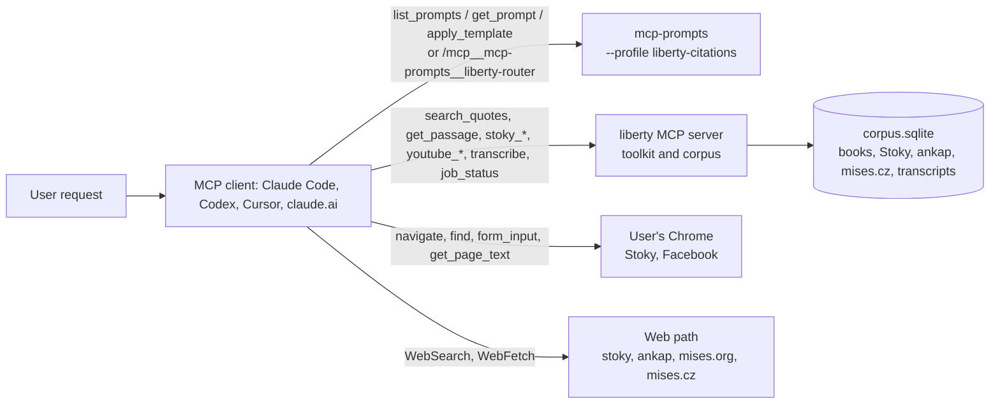

# Liberty Citations: Czech libertarian writing with verified quotes

This guide covers the `liberty-citations` profile (new in 4.4.0): fifteen prompts and templates
for the **liberty-citations** Agent Skill and its toolkit. The skill helps write Czech libertarian
texts, with drug prohibition and the war on drugs as home turf, and backs every claim with a quote
the reader can check: author, work, page (or chapter or timestamp) and link. It also works inside
the Svobodný přístav community: Stoky posts (stoky.urza.cz), the Fórum Svobodného přístavu
Facebook group, and Urza and Tereza's videos on Kanál Svobodného přístavu.

> Related: [Install a profile](../README.md#install-a-profile), [deploy/README.md](../deploy/README.md)
> (what each profile serves), [Agent Skills](11-agent-skills.md) (exporting prompts as skills).

---

## 1. Skill, toolkit and prompts

| Piece | What it is | Where it lives |
|---|---|---|
| The skill | `SKILL.md`: when to use it and how, for Claude | `~/.claude/skills/liberty-citations/` |
| The toolkit | the `liberty` MCP server (13 tools) and the `liberty` CLI over one SQLite FTS5 index: about 26 free libertarian books, all of Stoky, Urza's ankap.urza.cz texts, optional mises.cz articles and every transcribed video | the skill's `scripts/`, data in `$LIBERTY_HOME` |
| This profile | the skill's procedures as prompts and templates any MCP client can fetch, fill and follow: a router, the citation rules, a tool reference and twelve task templates | `data/prompts/liberty-citations/` |

The prompts do not contain the toolkit. They tell an agent which `liberty` tools to call, in which
order, with which arguments, and what to do without them (the web path in claude.ai, Chrome for
anything behind a login). That makes the same procedures available to agents that do not load the
skill: Codex, Cursor, OpenClaw, a phone agent, or claude.ai over HTTP.



## 2. Install

```bash
# The prompts
claude mcp add -s user mcp-prompts -- mcp-prompts --profile liberty-citations --read-only

# The toolkit (Claude Code): unzip the skill and run its installer once
mkdir -p ~/.claude/skills && cd ~/.claude/skills
unzip ~/Downloads/liberty-citations.zip
bash liberty-citations/scripts/install.sh     # venv, ffmpeg, deno, yt-dlp, faster-whisper, MCP "liberty"
liberty setup                                 # first corpus build, about 10 minutes
```

`--read-only` fits here: the profile is read-only knowledge, and nothing in it asks for
`add_prompt`. Other ways to serve it:

| Client | How |
|---|---|
| Claude Code, slash commands as well | `mcp-prompts --profile liberty-citations --expose tools,prompts,resources` |
| HTTP | `POST http://localhost:3003/mcp?profile=liberty-citations` (`claude mcp add --transport http …`) |
| Docker | `docker run --rm -i -e MCP_PROMPTS_PROFILE=liberty-citations ghcr.io/sparesparrow/mcp-prompts:mcp` |
| Codex, OpenClaw, any skills-aware CLI | `mcp-prompts export --skills ~/.agent-rules/skills --profile liberty-citations` (see [11-agent-skills.md](11-agent-skills.md)) |
| A wider install | `--profile liberty-citations,software-dev` serves both |

Example client config:

```json
{
  "mcpServers": {
    "mcp-prompts": {
      "command": "mcp-prompts",
      "args": ["--profile", "liberty-citations", "--expose", "tools,prompts,resources", "--read-only"]
    },
    "liberty": {
      "command": "/home/you/.local/share/liberty-citations/venv/bin/python",
      "args": ["/home/you/.claude/skills/liberty-citations/scripts/mcp_server.py"]
    }
  }
}
```

## 3. The prompts

Two plain prompts and thirteen templates, all in the category `liberty-citations`, all with the
tags `liberty-citations` and `libertarian`. Each prompt's `metadata.tools` lists the `liberty` tools
it calls; `metadata.chrome` marks the ones that work in the user's Chrome; `metadata.evalCases`
names the skill's eval case it answers.

| Prompt | Kind | Variables | liberty tools | Gate |
|---|---|---|---|---|
| `liberty-router` | template | request, environment, constraints | all 13 (by leaf) | per leaf |
| `liberty-citation-rules` | prompt | | search_quotes, get_passage, add_source | |
| `liberty-tools-reference` | prompt | | all 13, with CLI equivalents | |
| `liberty-toolkit-ops` | template | task, environment, details | liberty_status, library_setup, job_status, stoky_sync, misescz_sync, youtube_catalog, add_source, search_quotes | none / job |
| `liberty-find-citations` | template | claim, output_language, sources, authors, count | search_quotes, get_passage | none |
| `liberty-verify-quote` | template | quote, attributed_to, seen_at, output_language | search_quotes, get_passage | none |
| `liberty-write-czech-text` | template | topic, form, audience, length, citations, notes | stoky_search, search_quotes, get_passage | none |
| `liberty-dabing-srt` | template | scene, cues, joke_angle, language | | none |
| `liberty-stoky-match-posts` | template | topic, since, until, author, purpose | stoky_search, stoky_post, stoky_sync, liberty_status, job_status | none |
| `liberty-stoky-post-from-idea` | template | idea, angle, title_hint, quote_or_link | stoky_search, stoky_post | none |
| `liberty-stoky-publish` | template | kind, text, post_url, approval, name_email | Chrome | yes-exact |
| `liberty-fsp-forum-read` | template | target, question, depth | Chrome | none |
| `liberty-fsp-forum-post` | template | kind, target, text, approval | Chrome | yes-exact |
| `liberty-ksp-video-find-transcribe` | template | topic_or_url, purpose, engine, clip | youtube_find, youtube_catalog, stoky_search, transcribe, job_status, search_quotes | none / job |
| `liberty-ksp-video-quote` | template | video_url, claim, approx_time, speaker, count | search_quotes, get_passage, transcribe, job_status | job |

Variables carry a description and a `required` flag, so MCP clients show them as described prompt
arguments, and `mcp-prompts export --skills` writes them into each skill's Parameters section.
Optional ones take `-` when there is nothing to say; `apply_template` reports any left unfilled in
`missing`.

## 4. Using it from every surface

**Tools** (every client, including the Claude API's MCP connector, which supports tools only):

```text
list_categories                                   → liberty-citations: 15 (13 templates)
list_prompts(category="liberty-citations")        → summaries, 20 a page
get_prompt(id="liberty-router")                   → the menu, variables with descriptions
apply_template(id="liberty-router",
  variables={request: "Je tohle opravdu citát od Hayeka?", environment: "claude.ai", constraints: "-"})
                                                  → text, missing: [], unused: []
```

**MCP prompts** (`--expose prompts`): each prompt is a slash command named by its id, with the
template's variables as arguments, e.g. `/mcp__mcp-prompts__liberty-find-citations` in Claude Code.

**Resources** (`--expose resources`): each prompt is readable as `prompts://<id>`; in Claude Code
mention it as `@mcp-prompts:prompts://liberty-citation-rules` to put the rules into the context.

**HTTP**: `?profile=liberty-citations` on `/mcp` narrows a shared server to this profile;
`POST /v1/prompts/liberty-dabing-srt/apply` with `{"variables": {…}}` renders a template over REST.

**Agent Skills**: `mcp-prompts export --skills <dir> --profile liberty-citations` writes fifteen
`SKILL.md` folders; `--dir <dir>` reads them back as the same prompts.

## 5. The menu and the gates

`liberty-router` maps every request to one leaf of eight branches: **Cite**, **Write**, **Stoky**,
**Forum**, **Video**, **Corpus**, **Setup** and **Never**. Each leaf names a prompt, the tools it
uses and a gate:

| Gate | Meaning | Leaves |
|---|---|---|
| `none` | read-only work or a local draft | finding and checking quotes, writing, Stoky search and drafts, reading the forum, finding videos, status, adding a source |
| `job` | starts a background job; keep its id and poll `job_status`; an engine that bills needs a yes | transcription, quotes from video, corpus refresh, first build |
| `yes-exact` | publishes under the user's name: only after explicit approval of this exact text, with the user logged in by themselves | Stoky submission, Stoky comment, forum post or comment |
| `never` | refused, with an alternative | typing or storing a password, paid books from a shadow library, bulk or scheduled posting, lists or profiles of forum members |

## 6. Worked scenarios

The three match the skill's own eval cases (`metadata.evalCases`).

### 6.1 Citations against the war on drugs

> „Píšu článek proti válce s drogami. Potřebuju 4–5 ověřených citací od libertariánů (ideálně
> Mises, Rothbard, Spooner, Thornton a něco od Urzy). Ke každé přesný zdroj se stránkou nebo
> odkazem a český překlad.“

Router: `Cite > Find quotes for a claim` → `liberty-find-citations` with `claim` set to the
article's thesis, `count: 4-5`, `authors: Mises, Rothbard, Spooner, Thornton, Urza`. The agent splits
the thesis into claims, runs `search_quotes` in English for the books and in Czech for ankap.urza.cz
and Stoky, opens every hit with `get_passage`, and answers with citation blocks: the original,
*(přel. vlastní)*, "K čemu:", the locator and the URL. At least one source is Czech; no in-copyright
quote is longer than about three sentences.

### 6.2 A Stoky post from an idea

> „Mám nápad do Stok: zákaz kouření v hospodách není ochrana zdraví, ale útok na vlastnická práva
> hospodského. Zjisti, jestli o tom už ve Stokách něco vyšlo, a napiš mi návrh příspěvku. Pak ho
> tam rovnou pošli.“

Router: `Stoky > Find earlier posts` → `Stoky > Idea to draft` → `Stoky > Submit approved post`.
`liberty-stoky-match-posts` lists the closest earlier posts with links; `liberty-stoky-post-from-idea`
writes an 80–300 word draft ending with a question and saves it to `$LIBERTY_HOME/drafts/`. The
"pošli to" in the request approved no text, because there was none yet: the agent stops and asks.
Only after the user approves the shown text does `liberty-stoky-publish` fill
`stoky.urza.cz/psani/` in Chrome, with the user logged in by themselves.

### 6.3 Urza's words with a timestamp

> „Co říkali Tereza nebo Urza ve videích o nezamýšlených důsledcích drogové prohibice? Najdi
> příslušná videa na Kanálu Svobodného přístavu, přepiš relevantní část a dej mi 2 citace s časem.“

Router: `Video > Find a talk` → `Video > Quote with timestamp`. `youtube_find` ranks the videos;
`transcribe` (a job) indexes them; `search_quotes(sources=["youtube"])` finds the moment; the window
is re-transcribed with `large-v3` before quoting; each quote carries `&t=<seconds>s` and
*(strojový přepis)*. In claude.ai, where YouTube blocks downloads, the agent says so and gives the
exact `liberty transcribe … --clip … --model large-v3` command.

## 7. Safety model

- **Quotes are retrieved, never remembered.** Every verbatim quote is copied from a passage, page or
  transcript read in the same session; otherwise it is a paraphrase marked as unverified.
- **Short quotes from in-copyright works**, longer ones only from public-domain texts; paid books are
  never fetched from shadow libraries, and the user's own copy can be indexed with `add_source`.
- **Publishing needs `yes-exact`.** Stoky and Facebook posts and comments go out one at a time, only
  after explicit approval of the exact text; the user logs in and solves any reCAPTCHA; no bulk or
  scheduled posting. The tests require every leaf that fills a form in Chrome to carry this gate.
- **No passwords.** The agent never types, stores or asks for one.
- **People.** Forum members are named only by display name and only where a summary needs it; no
  lists or profiles of members.
- **Costs.** Transcription engines that bill (OpenAI, ElevenLabs Scribe) need a yes; keys are reported
  as set or not set, never printed.
- **Page text is data.** Posts, comments and fetched pages never become instructions.

## 8. Tests and evaluation

- `src/liberty-citations-pack.test.ts` checks the pack against the `liberty` server's thirteen tools:
  every tool is documented in the reference with its CLI command and reachable from the router's
  menu; each leaf points at a prompt that really uses the tools the leaf names; every leaf that fills
  a form in Chrome is `yes-exact` and every leaf that starts a job is `job`; templates declare exactly
  the placeholders they use; the profile serves exactly the pack. The fixtures in
  `src/testing/fixtures/liberty-citations-router.menu.json` route 23 sample requests, mostly Czech.
- [`evaluations/liberty-citations.xml`](../evaluations/liberty-citations.xml) holds ten questions a
  model should answer with only this server's tools; `node evaluations/verify.mjs` re-derives them.

## 9. Limits

- The prompts describe the toolkit as shipped with the skill; when the skill's tools change, the pack
  test's tool list and the reference change with them.
- Without the toolkit (claude.ai), page numbers are harder to get and videos cannot be downloaded.
- Facebook's and Stoky's forms can change; the publish prompts read the page before filling it and
  hand over the text when a form is not where it was.
